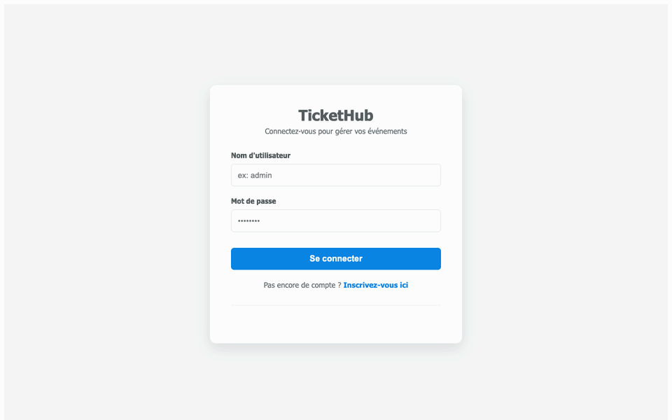
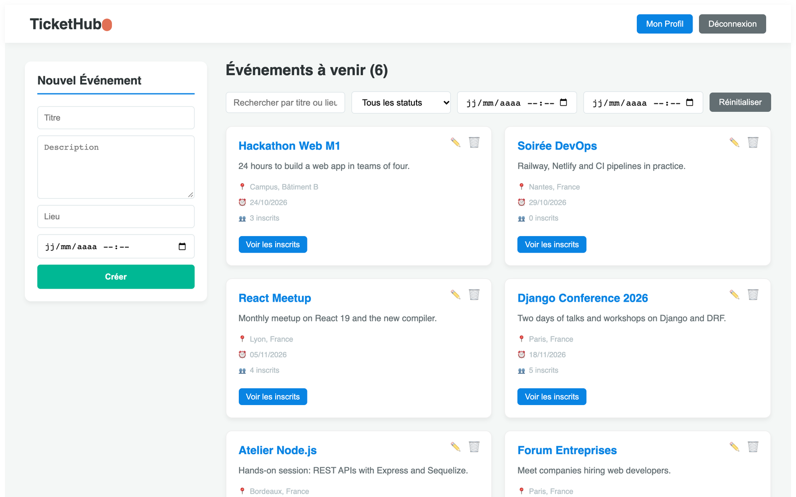
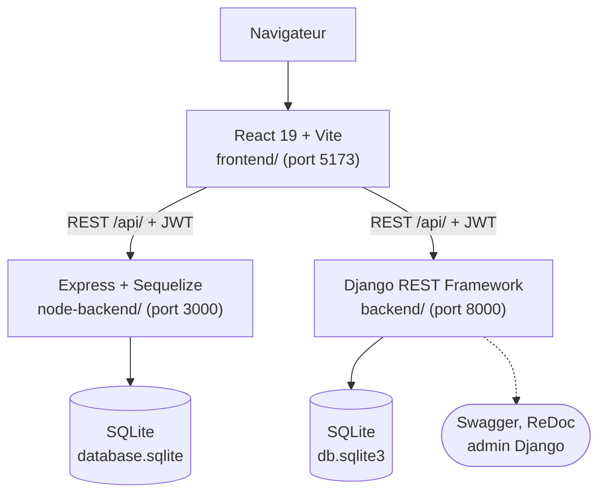
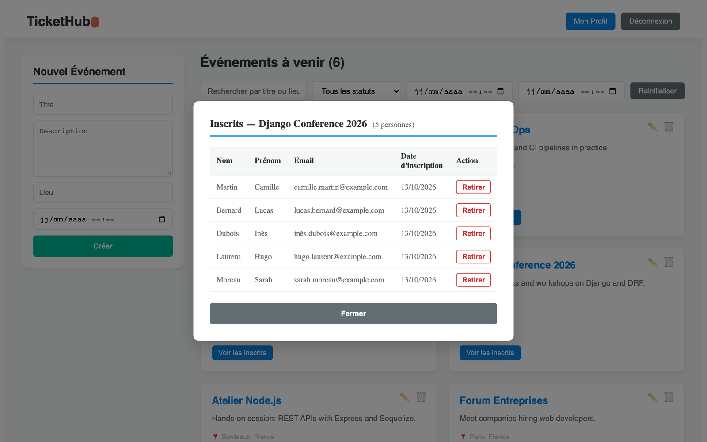

<p align="right"><a href="./README.md">English</a> | <b>Français</b></p>

<h1 align="center">EventHub</h1>

<p align="center">
  <a href="https://react.dev"></a>
  <a href="https://vite.dev"></a>
  <a href="https://www.djangoproject.com"></a>
  <a href="https://expressjs.com"></a>
  <a href="https://www.sqlite.org"></a>
  <a href="LICENSE"></a>
</p>

> **Un gestionnaire d'événements fullstack avec authentification JWT et trois rôles, servi par un frontend React et deux backends interchangeables (Django REST Framework et Node.js/Express).**

Les organisateurs créent et modifient des événements, suivent les inscrits et consultent des statistiques globales. Les visiteurs parcourent les événements à venir, les filtrent et s'inscrivent en un clic. La même interface React (baptisée TicketHub) dialogue avec l'un ou l'autre backend : les deux exposent la même API REST, ce qui fait du projet une comparaison concrète entre Django + DRF et Express + Sequelize. Une version en ligne tourne sur [Netlify](https://ticket-hub-m1.netlify.app), avec l'API Node.js sur Railway.

<p align="center">
  <a href="#points-forts">Points forts</a> ·
  <a href="#fonctionnement">Fonctionnement</a> ·
  <a href="#démarrage-rapide">Démarrage rapide</a> ·
  <a href="#api">API</a> ·
  <a href="#déploiement">Déploiement</a> ·
  <a href="#structure-du-projet">Structure du projet</a>
</p>

<p align="center">
  
</p>

---

## Points forts

- **Accès par rôle** : `admin` a tous les droits, `editor` crée et modifie les événements, `viewer` consulte les événements et s'y inscrit. Les permissions sont appliquées par l'API, pas seulement masquées dans l'interface.
- **Authentification JWT** : côté Django, le token d'accès dure 1 heure et le refresh token 7 jours, avec rotation et blacklist à la déconnexion. Le frontend envoie le token à chaque requête et renvoie vers la page de connexion en cas de 401.
- **Événements et inscriptions** : CRUD complet avec quatre statuts (`planned`, `ongoing`, `completed`, `cancelled`), filtres par statut et par période, recherche, nombre d'inscrits par événement, contrainte d'unicité (événement, participant) et inscription impossible à un événement annulé.
- **Vue organisateur** : liste des inscrits par événement avec nom, email et date, et retrait d'une inscription (admin uniquement).
- **Endpoint de tableau de bord** : totaux d'événements, de participants et d'inscriptions, répartition par statut et cinq prochains événements.
- **Deux backends, un seul contrat** : on passe de l'un à l'autre en changeant l'URL de l'API ; le backend Django ajoute Swagger, ReDoc et l'admin Django.

<p align="center">
  
</p>

---

## Fonctionnement



- `frontend/src/api/axios.js` définit l'URL de l'API (`VITE_API_URL`, par défaut `http://localhost:3000/api/`), ajoute l'en-tête `Authorization: Bearer` et gère les tokens expirés. Les pages sont dans `frontend/src/pages/` (connexion, inscription, tableau de bord, profil).
- `backend/` est un projet Django à deux applications : `accounts` (utilisateur personnalisé avec rôle, vues JWT, permissions) et `events` (modèles, serializers, filtres, vues, commande `seed`).
- `node-backend/src/` réimplémente la même API avec `routes/`, `controllers/`, `middleware/` (vérification du JWT, du rôle, gestion des erreurs) et des modèles Sequelize. Au démarrage, il crée les tables et les comptes `admin`, `editor` et `viewer` si la base est vide (`seed.js`).

---

## Démarrage rapide

Prérequis : Python 3.10+, Node.js 18+ et npm.

```bash
git clone https://github.com/Yvngval/Projet_Web.git
cd Projet_Web
```

**Backend Node.js** (celui qu'utilise le frontend par défaut) :

```bash
cd node-backend
npm install
npm run dev        # http://localhost:3000/api/
```

**Backend Django**, avec un fichier `.env` à la racine du dépôt :

```env
SECRET_KEY=your-django-secret-key
DEBUG=True
ALLOWED_HOSTS=127.0.0.1,localhost
CORS_ALLOWED_ORIGINS=http://localhost:5173,http://127.0.0.1:5173
```

```bash
cd backend
python -m venv venv
source venv/bin/activate      # Windows: venv\Scripts\activate
pip install -r requirements.txt
python manage.py migrate
python manage.py seed          # optional: demo users, 5 events, 5 participants
python manage.py runserver     # http://localhost:8000/api/
```

**Frontend** :

```bash
cd frontend
npm install
npm run dev        # http://localhost:5173
```

Pour utiliser le backend Django, lancez le frontend avec `VITE_API_URL=http://127.0.0.1:8000/api/ npm run dev`.

**Tests** : le backend Django compte 35 tests qui couvrent l'authentification, les permissions par rôle, le CRUD et les règles métier (doublons, événements annulés). Lancez-les avec `python manage.py test` depuis `backend/`. Le frontend se vérifie avec `npm run lint`.

---

## API

| Ressource | Endpoints | Accès |
|---|---|---|
| Authentification | `POST /api/auth/register/`, `POST /api/auth/login/`, `GET /api/auth/me/` | public, puis authentifié |
| Tokens (Django) | `POST /api/auth/token/refresh/`, `POST /api/auth/logout/`, `POST /api/auth/change-password/`, `GET /api/auth/users/` | authentifié, liste des utilisateurs pour l'admin |
| Événements | `GET`, `POST /api/events/` ; `GET`, `PUT`, `DELETE /api/events/<id>/` | lecture pour tous, écriture pour admin et editor |
| Inscription en libre-service | `POST /api/events/<id>/register/`, `DELETE /api/events/<id>/unregister/` | authentifié (viewer uniquement sur Node.js) |
| Participants | `GET`, `POST /api/participants/` ; `GET`, `PUT`, `DELETE /api/participants/<id>/` | admin et editor |
| Inscriptions | `GET`, `POST /api/registrations/` ; `GET`, `DELETE /api/registrations/<id>/` | admin et editor |
| Tableau de bord | `GET /api/dashboard/` | admin et editor |

Avec le backend Django, la documentation interactive est sur `/api/docs/` (Swagger) et `/api/redoc/`, et l'admin sur `/admin/`. Le backend Node.js sert aussi `GET /api/events/me/registrations` pour les inscriptions du viewer connecté. Le détail par backend se trouve dans [`backend/README.md`](backend/README.md) et [`node-backend/README.md`](node-backend/README.md), ce dernier avec une comparaison des deux stacks.

<p align="center">
  
</p>

---

## Déploiement

| Partie | Hébergeur | Réglages |
|---|---|---|
| Frontend | [Netlify](https://ticket-hub-m1.netlify.app) | dossier de base `frontend`, build `npm run build`, publication `dist`, `VITE_API_URL` défini avant le build |
| API Node.js | [Railway](https://railway.app) | `railway up` depuis `node-backend/`, variables `DB_PATH`, `JWT_SECRET`, `PORT` |

`frontend/netlify.toml` redirige toutes les routes vers `index.html` pour que React Router fonctionne au rechargement. La base SQLite sur Railway est réinitialisée à chaque redéploiement ; les trois comptes de base sont recréés au démarrage par `seed.js`.

---

## Structure du projet

```text
backend/          Django + DRF API
  accounts/       custom user, roles, JWT views, permissions
  events/         events, participants, registrations, dashboard, seed command
  eventhub/       settings, URLs, error handler
node-backend/     Express + Sequelize API with the same endpoints
frontend/         React + Vite interface (TicketHub)
docs/assets/      screenshots used in this README
```

---

## Contribuer

Les issues et pull requests sont les bienvenues. Consultez [CONTRIBUTING.md](CONTRIBUTING.md).

## Licence

Publié sous [licence MIT](LICENSE).

## Auteurs

<a href="https://github.com/Yvngval"></a>
<a href="https://github.com/chatodit"></a>
<a href="https://github.com/SedikRummenigge"></a>

Valentin Ponnoussamy ([@Yvngval](https://github.com/Yvngval)), [@chatodit](https://github.com/chatodit) et [@SedikRummenigge](https://github.com/SedikRummenigge), 2026.
