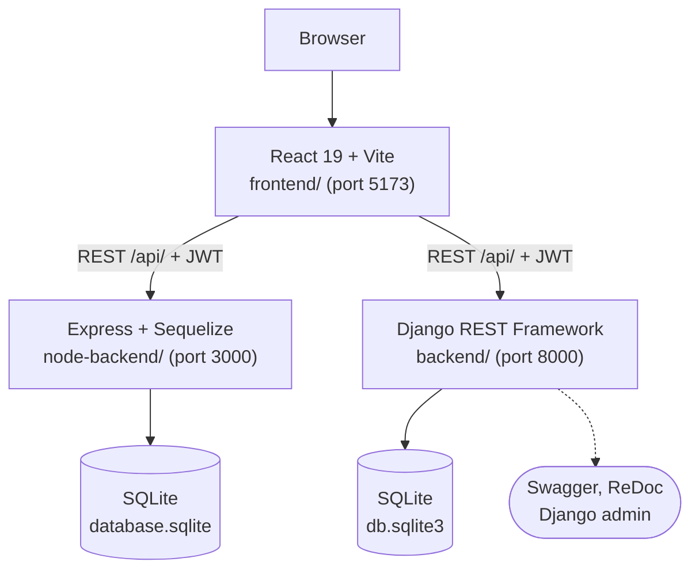

<p align="right"><b>English</b> | <a href="./README.fr.md">Français</a></p>

<h1 align="center">EventHub</h1>

<p align="center">
  <a href="https://react.dev"></a>
  <a href="https://vite.dev"></a>
  <a href="https://www.djangoproject.com"></a>
  <a href="https://expressjs.com"></a>
  <a href="https://www.sqlite.org"></a>
  <a href="LICENSE"></a>
</p>

> **A full-stack event manager with JWT authentication and three roles, served by a React frontend and two interchangeable backends (Django REST Framework and Node.js/Express).**

Organizers create and edit events, follow who registered and see global statistics. Visitors browse upcoming events, filter them and register in one click. The same React interface (branded TicketHub) talks to either backend: both expose the same REST API, which makes the project a side-by-side comparison of Django + DRF and Express + Sequelize. A live version runs on [Netlify](https://ticket-hub-m1.netlify.app) with the Node.js API on Railway.

<p align="center">
  <a href="#highlights">Highlights</a> ·
  <a href="#how-it-works">How it works</a> ·
  <a href="#getting-started">Getting started</a> ·
  <a href="#api">API</a> ·
  <a href="#deployment">Deployment</a> ·
  <a href="#project-structure">Project structure</a>
</p>

<p align="center">
  
</p>

---

## Highlights

- **Role-based access**: `admin` has full access, `editor` creates and edits events, `viewer` reads events and registers for them. Permissions are enforced by the API, not only hidden in the UI.
- **JWT authentication**: access tokens last 1 hour and refresh tokens 7 days on the Django side, with rotation and blacklisting on logout. The frontend sends the token on every request and returns to the login page on a 401.
- **Events and registrations**: full CRUD with four statuses (`planned`, `ongoing`, `completed`, `cancelled`), filters by status and date range, search, a participant count per event, a unique constraint on (event, participant) and no registration to a cancelled event.
- **Organizer view**: list of registered people per event with name, email and date, and removal of a registration (admin only).
- **Dashboard endpoint**: totals of events, participants and registrations, breakdown by status and the next five events.
- **Two backends, one contract**: switch from one to the other by changing the API URL; the Django backend adds Swagger, ReDoc and the Django admin.

<p align="center">
  
</p>

---

## How it works



- `frontend/src/api/axios.js` sets the API URL (`VITE_API_URL`, default `http://localhost:3000/api/`), adds the `Authorization: Bearer` header and handles expired tokens. Pages live in `frontend/src/pages/` (login, registration, dashboard, profile).
- `backend/` is a Django project with two apps: `accounts` (custom user with a role, JWT views, permissions) and `events` (models, serializers, filters, views, a `seed` command).
- `node-backend/src/` reimplements the same API with `routes/`, `controllers/`, `middleware/` (JWT check, role check, errors) and Sequelize models. On startup it creates the tables and the `admin`, `editor` and `viewer` accounts if the database is empty (`seed.js`).

---

## Getting started

Prerequisites: Python 3.10+, Node.js 18+ and npm.

```bash
git clone https://github.com/Yvngval/Projet_Web.git
cd Projet_Web
```

**Node.js backend** (the one the frontend uses by default):

```bash
cd node-backend
npm install
npm run dev        # http://localhost:3000/api/
```

**Django backend**, with a `.env` file at the root of the repository:

```env
SECRET_KEY=your-django-secret-key
DEBUG=True
ALLOWED_HOSTS=127.0.0.1,localhost
CORS_ALLOWED_ORIGINS=http://localhost:5173,http://127.0.0.1:5173
```

```bash
cd backend
python -m venv venv
source venv/bin/activate      # Windows: venv\Scripts\activate
pip install -r requirements.txt
python manage.py migrate
python manage.py seed          # optional: demo users, 5 events, 5 participants
python manage.py runserver     # http://localhost:8000/api/
```

**Frontend**:

```bash
cd frontend
npm install
npm run dev        # http://localhost:5173
```

To use the Django backend, start the frontend with `VITE_API_URL=http://127.0.0.1:8000/api/ npm run dev`.

**Tests**: the Django backend has 35 tests covering authentication, role permissions, CRUD and the business rules (duplicates, cancelled events). Run them with `python manage.py test` from `backend/`. Lint the frontend with `npm run lint`.

---

## API

| Resource | Endpoints | Access |
|---|---|---|
| Authentication | `POST /api/auth/register/`, `POST /api/auth/login/`, `GET /api/auth/me/` | public, then authenticated |
| Tokens (Django) | `POST /api/auth/token/refresh/`, `POST /api/auth/logout/`, `POST /api/auth/change-password/`, `GET /api/auth/users/` | authenticated, users list for admin |
| Events | `GET`, `POST /api/events/`; `GET`, `PUT`, `DELETE /api/events/<id>/` | read for all, write for admin and editor |
| Self-registration | `POST /api/events/<id>/register/`, `DELETE /api/events/<id>/unregister/` | authenticated (viewer only on Node.js) |
| Participants | `GET`, `POST /api/participants/`; `GET`, `PUT`, `DELETE /api/participants/<id>/` | admin and editor |
| Registrations | `GET`, `POST /api/registrations/`; `GET`, `DELETE /api/registrations/<id>/` | admin and editor |
| Dashboard | `GET /api/dashboard/` | admin and editor |

With the Django backend, the interactive documentation is at `/api/docs/` (Swagger) and `/api/redoc/`, and the admin at `/admin/`. The Node.js backend also serves `GET /api/events/me/registrations` for the viewer's own registrations. Details per backend are in [`backend/README.md`](backend/README.md) and [`node-backend/README.md`](node-backend/README.md), the latter with a comparison of the two stacks.

<p align="center">
  
</p>

---

## Deployment

| Part | Host | Settings |
|---|---|---|
| Frontend | [Netlify](https://ticket-hub-m1.netlify.app) | base directory `frontend`, build `npm run build`, publish `dist`, `VITE_API_URL` set before the build |
| Node.js API | [Railway](https://railway.app) | `railway up` from `node-backend/`, variables `DB_PATH`, `JWT_SECRET`, `PORT` |

`frontend/netlify.toml` redirects every route to `index.html` so React Router works on reload. The SQLite database on Railway is reset on each redeploy; the three base accounts are recreated at startup by `seed.js`.

---

## Project structure

```text
backend/          Django + DRF API
  accounts/       custom user, roles, JWT views, permissions
  events/         events, participants, registrations, dashboard, seed command
  eventhub/       settings, URLs, error handler
node-backend/     Express + Sequelize API with the same endpoints
frontend/         React + Vite interface (TicketHub)
docs/assets/      screenshots used in this README
```

---

## Contributing

Issues and pull requests are welcome. See [CONTRIBUTING.md](CONTRIBUTING.md).

## License

Released under the [MIT License](LICENSE).

## Authors

<a href="https://github.com/Yvngval"></a>
<a href="https://github.com/chatodit"></a>
<a href="https://github.com/SedikRummenigge"></a>

Valentin Ponnoussamy ([@Yvngval](https://github.com/Yvngval)), [@chatodit](https://github.com/chatodit) and [@SedikRummenigge](https://github.com/SedikRummenigge), 2026.
